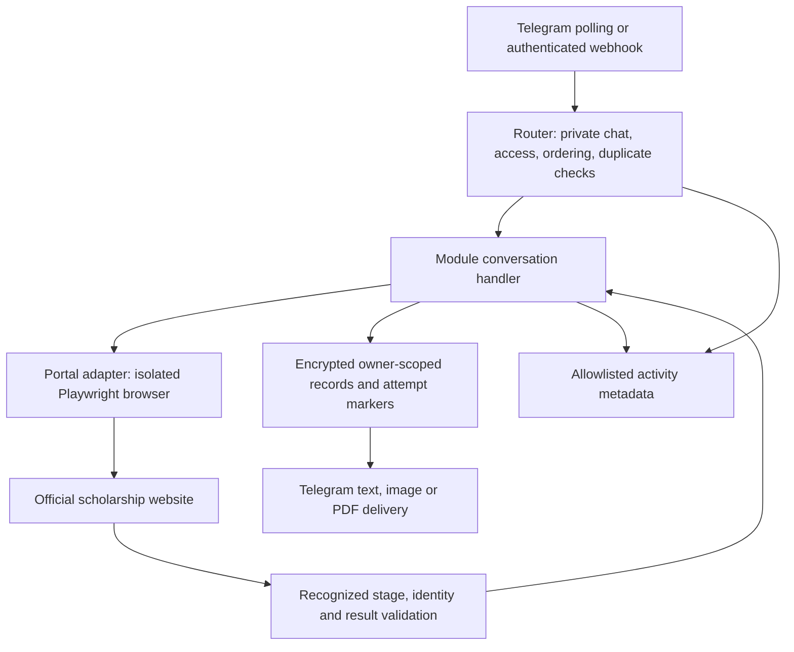

# Telespark — master project guide and developer handoff

Last reviewed: **24 October 2026 (IST)**. This guide describes the inspected code, not a guarantee that every government-portal branch works live. Read it first, then the linked module guides and current source. See [Oracle operations](ORACLE_OPERATIONS.md) for the VPS migration, capacity controls and validation limits. Where older documents disagree, verify the implementation and update the documentation.

## 1. Purpose and current status

Telespark is a Node.js Telegram bot for authorized users to operate the official UP Scholarship portal through private chats. It collects answers, drives an isolated Playwright browser, shows CAPTCHA images, accepts user-entered CAPTCHA/OTP answers, reviews sensitive submissions and delivers response images or validated PDFs. It does not decide eligibility or bypass portal verification.

There are five main menu options: password recovery, OTR, form filling, saved sessions, and form lock/final print. Admins also have access management, activity history and sequential Excel final-print batches. No AI model or AI subscription is required by the bot runtime.

### Local working locations

| Location | Purpose |
| --- | --- |
| `D:\electroshorts\outputs\telespark-publish-20261009` | Development Git checkout; observed branch `feature/otnew-poly`. Inspect and preserve any uncommitted work before changing it. |
| `D:\electroshorts\scholarship-telegram-bot` | Windows runtime directory, including private configuration and saved data. Disabled at Oracle cutover; it can differ from the checkout and its data becomes stale after VPS writes. |
| `master.md` in each directory | This guide; edit the checkout copy first, then synchronize the document. |

The historical repository is `KapitalV/Telespark`. Local changes do not imply that the remote repository or any deployment has those changes. This document does not assert that a bot process is currently running; inspect process and connection status when needed.

### Evidence and limits

| Capability | Current evidence / limitation |
| --- | --- |
| Oracle migration | On 22 October 2026, 295 unit/intercepted-browser tests passed on ARM64 with no failures/skips. Telegram synthetic PDF delivery, non-root service startup, forced-crash recovery and actual reboot recovery passed. Five simultaneous mock workflows completed 150 runs without errors. Windows polling is disabled. Authenticated OCI inspection confirmed the instance's attached security list/NSG allow stateful egress and its assigned default route points to an Internet Gateway; no corrective network setting was identified. Live portal access times out and applicant acceptance remains pending. See ORACLE_OPERATIONS.md. |
| Recovery, registration, saving, access, batch and print handling | Implemented with unit and intercepted-browser coverage. Tests use synthetic data and do not prove current portal availability. |
| OTR recovery | The module guide records a live recovered-result screenshot verified on 10 October 2026. |
| Fresh academic/personal/bank/fee mapping | Based on observed portal fields. Unknown controls and unsupported dependent branches stop. |
| Fresh/Renewal selection | Implemented before form login. Protected Renewal branches remain only partially mapped; fixture success is not live acceptance. |
| OBC route | Separate mapping includes admission dates, enrolment and residence, with the confirmed 1/3 matching-date rule. Chrome inspection confirmed Group 4 and the exact branch label Diploma in Electrical. Suggestions read current dropdown values; all live branches remain available for explicit selection, including coded/formatted names. Full/partial postbacks and dependent answer invalidation have fixture coverage. Automated live continuation and full submission still need verification. |
| Typed backward navigation | `/back` is handled before input collection and listed only in `/help`. Eleven navigation checks cover permissions, duplicate updates, dependent fields, credential cleanup, delivery failures and irreversible boundaries. Registration browser fixtures also verify password/CAPTCHA backtracking without a final POST. |
| Telegram startup connection | On 20 October 2026, 53 focused transport, instance-lock, webhook, activity, recovery and batch tests passed. Read-only live `getMe` and `getWebhookInfo` checks succeeded after intermittent DNS and connection failures were reproduced. Startup retries are bounded; persistent loss of internet access still requires connection repair. |
| Cross-menu saved-user shortcuts | On 20 October 2026, 178 default-suite tests passed and 8 browser-fixture tests were skipped. Ten new shortcut tests cover all five menus, direct CAPTCHA preparation, contextual type/route retention, owner checks, cleanup, duplicate commands, failed logins and explicit lock confirmation. The local authorized suffix-50 profile was checked for completeness without displaying values. The changed flow has not yet been verified through live Telegram and portal login. |
| School name and OBC declaration | On 20 October 2026, 66 focused tests passed with intercepted Edge fixtures enabled. School names accept spaced initials/full words and normalize pasted whitespace while retaining the portal length limit. The OBC reader can associate visible nearby declaration text with its mapped checkbox, without requiring a label element. Missing/hidden/ambiguous declarations still stop, and changed text invalidates review. Current Chrome was at login, so the reported live OBC declaration layout remains unverified. |
| Optional OBC personal fields | Per user instruction, disability type (`ddl_Handitype`) stays unselected and family ID (`txtfamilyid`) stays blank. Only those exact optional controls on OBC personal pages bypass the unknown-field stop while unanswered; existing values, required controls and other unknown fields still stop. Omissions appear in review and remain protected by the review token. All 64 focused tests passed with intercepted Edge fixtures on 20 October 2026; live acceptance is pending. |
| Lock and institution print | Prior live inspection established confirmation and locked/waiting states. A documented final page also returned a server error, delivered only as an INCOMPLETE diagnostic PDF. On 21 October 2026, optional browser OK declarations during verified final-print navigation gained same-tab/new-tab support; lock review remains separate and print POSTs stay blocked. All 41 focused final-print tests passed with offline Edge fixtures; the default suite passed 180 tests with 10 browser suites skipped. Live optional-dialog verification remains pending. See FINAL_PRINT.md. |
| OBC verification history | On 20 October 2026, after live Chrome label/ID/handler inspection, all 49 focused OBC/schema/Poly conversation tests passed with browser fixtures enabled. Exact Group 4 → Diploma in Electrical labels are covered for full/AJAX postbacks using synthetic option values. A preceding full run recorded 236 passes and 2 failures; the later Oracle run recorded above passed all 295 tests. Automated live section submission remains unverified. |

## 2. Copy-paste prompt for another developer or agent

Copy the following block and replace the task placeholder. Its operating rules do not grant permission for unrelated actions or override the receiving agent's higher-priority instructions.

```text
You are maintaining Telespark, an existing Node.js Telegram bot that operates
the official UP Scholarship portal using Playwright. Read master.md, applicable
repository instructions and the relevant module documentation before changing code.

Inspect the current source and runtime copies; preserve existing uncommitted work.
Treat verified code and current portal observations as evidence, and distinguish
them from historical requests or outdated documentation.

Preserve all five menu options, private-chat authorization, encrypted owner-only
records, user-entered CAPTCHA/OTP flows, review confirmations, duplicate protection,
browser cleanup and PDF validation. Excel batches must never lock applications.
Do not automatically repeat an uncertain submission.

Keep SC/ST/General and OBC field mappings separate. Inspect unfamiliar portal
controls before mapping them; ask the user about ambiguous field meanings or
choices. Do not guess selectors, applicant answers or success conditions.

Never place credentials, applicant records, encryption keys or raw portal contents
in source code, documentation or activity logs. Preserve local configuration,
keys and saved data when synchronizing application files.

Implement the requested change, run relevant regression tests, and report what
changed, what was tested and what remains unverified. Restart the local bot only
when authorized and verify exactly one consumer. Do not deploy remotely, push,
merge, lock applications or submit live forms beyond the user's authorized scope.

Current requested task: [INSERT TASK HERE].

For the outstanding OBC issue, use the user-authorized /saveuser50 profile through
the existing workflow. Identify the actual additional editable controls before
changing the OBC mapping. Never expose its saved password. This is a reproduction
instruction, not permission to submit or lock an application.
```

## 3. How users operate the bot

### Access and common behavior

Use a private chat. Send `/id` and give that Telegram ID to the admin if access is restricted. The admin grants access with `/adduser ID`. Groups and messages from bots are ignored. `/start` or `/menu` opens the main menu and clears the active conversation/browser. `/cancel` clears active state but retains encrypted saved records and existing Telegram messages.

Reply to the latest prompt and current CAPTCHA image. An answer to an older photo may be rejected. CAPTCHA solving and SMS OTP entry are performed by the user. Controls are stage-specific: `/retry` does not authorize replaying an uncertain submission. Most inactive conversations expire after 20 minutes; cleanup is also checked by a periodic timer.

Type `/back` to reopen the previous editable input. It is listed in `/help` only, with no button or mention in module prompts. Later dependent answers are cleared and re-asked; an automatic default reopened this way becomes a manual question. Going back from an unsubmitted CAPTCHA clears it or returns to review/password entry as appropriate. Navigation stops at completed verification, section-submission, locking, saved-result and uncertain-outcome boundaries. Excel batches keep their current candidate index and completed PDFs. Navigation does not undo external actions or replay OTP requests, submissions or printing.

### 1. Password recovery

Choose Fresh/Renewal, registration number, mobile number for Fresh or date of birth for Renewal, high-school board, passing year and roll number. Preserve leading zeros. `/boards` lists supported recovery boards.

After the six answers, the bot prepares the official recovery page and sends its CAPTCHA. Replying submits recovery, with an automatic encrypted save before submission. **Running `/save` or `/psave` first is not required.** A successful recovery returns the latest password and slip. A readable but unrecognized result may be sent as an unconfirmed screenshot; a result for a different registration is rejected. `/result` resends the retained result without another password reset. See [README recovery instructions](README.md).

### 2. OTR

- **Recover OTR:** registered mobile → CAPTCHA → SMS OTP and any further portal CAPTCHA → confirmed OTR/result image. The same browser keeps verification state. `/resend` works only when supported and the cooldown permits it.
- **Scholarship registration using OTR:** uses an existing OTR on the official scholarship registration form; asks the supported department/course route and current fields, including district/institution, category/religion, school details and chosen password. District defaults to the mapped Jalaun option; board buttons include UP BOARD and CBSE BOARD. Review and `YES` precede final submission. The official response screenshot alone does not prove registration success.

This second menu action is **not new OTR creation/e-KYC**. Older experimental new-OTR code exists separately. Do not connect it to the menu or declare it supported without explicit development and verification. See [OTR recovery](OTR_RECOVERY.md), [scholarship registration](SCHOLARSHIP_REGISTRATION.md) and [OTR testing](OTR_TESTING.md).

### 3. Form filling OTNew-Poly

Choose one action: **Fill/continue application**, **Verify income and caste**, or **Download check-print PDF**. Each new login asks:

1. Fresh or Renewal.
2. **1. SC / ST / General** or **2. OBC**.
3. Registration number, OTR and password. A selected `/saveuserNN` profile fills these automatically; ordinary `/reuse` answers still offer `USE SAVED`.
4. Current login CAPTCHA.

The category choice selects the bot's mapping; it does not change the category registered on the portal. OBC has separate section mappings. Its academic questions 15 and 16 ask admission dates in DD/MM/YYYY format; for first year of three years (1/3), date 16 must equal date 15 and offers it with USE DEFAULT. Question 17 asks an enrolment number of exactly E plus 14 digits, preserving leading zeros. Question 18 asks day scholar/residential using actual portal options. The SC/ST/General label groups the existing workflow and is not proof that every category-dependent branch is mapped.

OBC automatically fills its configured fixed defaults, including field 10 JEECUP, using available portal options. The review shows these answers before YES/CAPTCHA; `/edit` allows manual correction. Course, branch, applicant details and both admission-date questions remain prompted. A missing or portal-discarded default becomes a manual question rather than an automatic retry loop. SC/ST/General retains manual default selection.

For OBC, course field 2 suggests the portal's Diploma Engg. 3 yrs Group 4 option. Branch field 3 shows every non-placeholder option in the authenticated course-dependent dropdown, retaining original labels/values. The observed Diploma in Electrical label and canonical Electrical Engineering/Engg labels receive a suggestion only for one unambiguous match. These suggestions still require selection. The OBC adapter waits for full/partial postbacks and branch readiness, and clears dependent answers when a course is accepted. Missing/ambiguous targets are not guessed; unfamiliar editable controls still stop. The general schema remains unchanged. A 20 October Telegram reproduction established the old branch-name filter rejection. Follow-up live Chrome inspection confirmed the Course/Branch IDs, Group 3/4 course labels, Diploma in Electrical branch label and the Course `__doPostBack` handler. Numeric option values remain read at runtime rather than hardcoded. The cascade fixtures reproduce those labels/handler using synthetic values and do not establish end-to-end live acceptance.

After login the bot reads actual status, skipping already-completed entry/verification where supported. Prompted fields appear one at a time. Dropdowns use live options, with `/search words` and `/next` for large lists. OBC fixed defaults fill automatically; other suggestions require explicit selection. All answers can be corrected in review.

| Section | Questions and current defaults |
| --- | --- |
| Academic | Study mode, supported Diploma course/branch, current course year (1 default; 2 and 3 selectable when present), qualification, technical board, admission and counselling details. Defaults include regular, High School, direct admission No, lateral No, counselling Yes/JEECUP; counselling year 2026 only for a detected 2026–27 session. Registration, rank and cutoff are separate questions. |
| High school | Passing year, total marks (600 default), obtained marks, board, school and mapped fee field (634 default). Percentage is obtained ÷ total × 100, two decimals. Only the mapped High School row is filled; a populated unused Intermediate row stops for review. |
| Personal | Parents' status. The both-alive mapping offers father occupation private/autonomous, asks father's income, offers mother occupation homemaker and income zero. Other dependent branches may stop. |
| Bank | Bank, district, branch, account number, repeated account number and passbook name individually. The two account entries must match; the portal's IFSC is reviewed. |
| Fee | Annual compulsory non-refundable fee defaults to 11010, subject to review. |
| Certificates | Income application/certificate numbers and caste application/certificate numbers separately. Retrieved records must match; user replies `MATCH` or `MISMATCH` before verification. |

Each supported section shows a review and declaration, requests `YES`, then the current CAPTCHA. `/edit` corrects the current section. Automatic saving precedes submission; unknown outcomes stop without replay.

The fill action continues to income/caste verification, then check print once verification is confirmed. The authenticated official print page supplies a PDF download or is rendered using its print layout. Readability and registration identity are validated before saving and sending a downloadable PDF. **Check print does not lock or forward the application.** See [OTNew-Poly details](OTNEW-POLY.md).

### 4. Saved sessions and saved users

`/save` lists records/statuses. `/save SESSION_ID` retrieves the owner's saved details. `/reuse SESSION_ID` opens a new conversation with reusable answers and requires fresh login/verification. `/result D0001` or `/result L0001` retrieves the owner's saved PDF without portal submission. Registration/recovery retrieval also uses `/dsave` and `/psave`.

To create a reusable login profile: `/saveuser` → OTR → registration → configured default password or Other. The password is encrypted and hidden in saved-detail displays. The bot returns a D record ID and `/saveuserNN`, where NN is the final two OTR digits. This shortcut is scoped to the owning user, not a global applicant identifier.

Two different OTRs with the same suffix for one owner cannot overwrite each other. An eligible draft/ready profile for the same OTR may be updated; protected attempt/result records are not overwritten.

Send `/saveuserNN` at the start/menu to select the profile, then choose any of the five options. The selection survives menu navigation for up to 20 minutes between uses. `/cancel`, revocation, expiry and restart clear the selection, without deleting the encrypted record. The selection itself stores only the record ID and suffix in memory; owner checks apply when loading its fields.

For Form filling, choose action, Fresh/Renewal and category; the saved registration, OTR and password then lead directly to the login CAPTCHA, without three `USE SAVED` prompts. If you send the shortcut after choosing these options, they are retained and a fresh CAPTCHA is prepared immediately. For individual Final Print, choose Fresh/Renewal once, then answer CAPTCHA. A shortcut within that login retains the chosen type. Rejected passwords are requested again; no automatic login loop occurs.

Password recovery reuses registration and asks the missing mobile/date-of-birth and school details. Scholarship registration reuses only the OTR, not the old login password as a new registration password. OTR recovery still requires its registered mobile number because login profiles do not store it. Saved sessions remain available through option 4. An active Excel batch cannot be replaced with a single-user shortcut.

Profile selection does not submit a section, verify a certificate or lock an application. Existing reviews, `YES`, `MATCH`, CAPTCHA and OTP steps remain. Switching category routes drops reusable form answers while preserving login identity. See [encrypted saved sessions](SAVED_SESSIONS.md) and [profile shortcut tests](test/profile-shortcut.test.mjs).

### 5. Form lock and Final Print

Choose Fresh/Renewal, enter registration and OTR, select the configured password preset or Other, then answer CAPTCHA. The bot verifies the dashboard identity and reads enabled controls, not numbered screen positions.

If locking is needed, it shows the applicant, portal notice and exact confirmation warning for `YES`. It makes one authorized attempt; changed warnings require renewed review. If final print is already available, locking is skipped. A locked application without an enabled print link returns a waiting status; the bot cannot remove a portal waiting period.

Available final PDFs are validated and saved as L records. A recognized server-error printout is explicitly labelled **INCOMPLETE**, not a valid application; saved retrieval preserves that warning. Printing/delivery failures never automatically repeat locking. See [Final Print](FINAL_PRINT.md).

### Admin-only Excel final-print batches

`/finaltemplate` downloads the workbook; `/finalbatch` requests an upload. Use the `Candidates` sheet with Candidate Name (optional), Application Type (Fresh/Renewal), Registration Number and OTR Number. Identifiers must be text, not formulas or numeric conversions. No passwords belong in Excel. Limit: 2 MB and 100 candidates.

The bot reports valid/invalid/duplicate rows, asks `YES`, then a configured Gpm/Deepak preset or Other. Candidates run sequentially in isolated browsers, with a user CAPTCHA for each. A password correction affects only that candidate. Unlocked or print-unavailable candidates are reported and skipped. **No batch path may lock an application.**

PDF delivery failure pauses for retry of the saved PDF. `/skip` advances; `/batchstatus` shows progress. The completion CSV includes row number, registration, status and saved PDF ID. Restart/cancellation clears the pending queue; there is no automatic batch resume. Upload remaining rows after checking outcomes. See [batch guide](FINAL_BATCH.md).

### Command reference

| Command | Purpose / restriction |
| --- | --- |
| `/start`, `/menu`, `/cancel` | Menu/reset or clear active conversation. |
| `/id`, `/help` | User ID and current help. |
| `/test` | Bot receipt check with 200 OK and metadata log; does not verify the portal. Malformed arguments return a structured error and flag admin with rate limiting. |
| `/otr`, `/boards` | OTR menu; recovery board list. |
| `/refresh`, `/retry`, `/resend` | Stage-specific CAPTCHA refresh, failed-load/delivery retry, or supported OTP resend. |
| `/search words`, `/next`, `/edit` | Supported option search/pagination and current Poly section editing. |
| `/save`, `/save SESSION_ID`, `/save PAGE` | Save/list or retrieve records; numeric dashboard pages contain ten records. |
| `/dsave`, `/psave` | Optional registration/recovery save or retrieval; accept SESSION_ID or `list [page]`. |
| `/reuse SESSION_ID`, `/result [SESSION_ID]` | Fresh flow from saved answers; retained/saved output retrieval. Availability depends on module/result type. |
| `/saveuser`, `/saveuserNN` | Create/select an owner-specific encrypted login profile across the five menus; supported logins fill credentials automatically. |
| `/admin`, `/adduser ID`, `/removeuser ID`, `/users` | Admin-only access controls. Revocation clears the user's active session. |
| `/log`, `/log COUNT`, `/log user ID [COUNT]` | Admin-only activity history; COUNT 1–100. |
| `/log export YYYY-MM-DD`, `/log help` | Admin daily JSONL download (bounded to 20 MB) or log help. |
| `/save user ID [PAGE]` | Admin status metadata for another user; does not grant private-result access. |
| `/finaltemplate`, `/finalbatch`, `/batchstatus`, `/skip` | Admin-only batch operations. |

## 4. Developer architecture



The handler decides which question/review to show; the portal adapter owns selectors, navigation, postbacks and result recognition. Keep these layers separate. Saving an attempt before submission prevents unsafe replay; retrying delivery uses the retained result, not another portal submission.

| Area | Main files |
| --- | --- |
| Composition and transport | [bot.mjs](bot.mjs), [telegram-api.mjs](telegram-api.mjs), [webhook.mjs](webhook.mjs), [telegram-files.mjs](telegram-files.mjs) |
| Routing, access and logging | [router.mjs](router.mjs), [access.mjs](access.mjs), [activity.mjs](activity.mjs) |
| Typed backward navigation | [navigation.mjs](navigation.mjs), [navigation tests](test/navigation.test.mjs); registration uses `RegistrationPortal.editPrevious` to invalidate dependent answers without submitting. |
| Password recovery | [core.mjs](core.mjs), [portal.mjs](portal.mjs), [board-options.mjs](board-options.mjs) |
| OTR | [otr-core.mjs](otr-core.mjs), [otr-recovery.mjs](otr-recovery.mjs), [otr-portal.mjs](otr-portal.mjs), [otr-schema.mjs](otr-schema.mjs) |
| Scholarship registration | [registration-core.mjs](registration-core.mjs), [registration-portal.mjs](registration-portal.mjs) |
| Form filling | [poly-core.mjs](poly-core.mjs), [poly-portal.mjs](poly-portal.mjs), [poly-schema.mjs](poly-schema.mjs) |
| OBC mapping/factory | [poly-obc-schema.mjs](poly-obc-schema.mjs), [poly-obc-portal.mjs](poly-obc-portal.mjs) |
| PDF validation and visible mode | [poly-pdf.mjs](poly-pdf.mjs), [poly-headless.mjs](poly-headless.mjs) |
| Lock/final print | [final-core.mjs](final-core.mjs), [final-portal.mjs](final-portal.mjs), [final-errors.mjs](final-errors.mjs) |
| Excel batches | [final-batch.mjs](final-batch.mjs), [batch-workbook.mjs](batch-workbook.mjs), [template](assets/Final_Print_Batch_Template.xlsx) |
| Encrypted persistence | [saved-sessions.mjs](saved-sessions.mjs), [saved-store.mjs](saved-store.mjs), [saved-schema.mjs](saved-schema.mjs) |
| Single-instance protection | [instance-lock.mjs](instance-lock.mjs) |

`PolyPortal` receives a section mapping; `ObcPolyPortal` gives it an independent cloned OBC mapping. `createPolyPortal` selects the adapter using `categoryRoute`. The handler passes both `applicationType` and `categoryRoute`. Saved type/category are references, not permission to skip those menus on a new login. Do not broaden portal origin/path/field allowlists merely to suppress an unsupported-page error.

## 5. Persistence, privacy and failure guarantees

| Prefix | Records |
| --- | --- |
| R0001…R9999 | Scholarship registration |
| D0001…D9999 | Form-filling sessions, saved-user profiles and check-print PDFs |
| P0001…P9999 | Password recovery |
| L0001…L9999 | Lock attempts and final PDFs, including batch results |

Sequences are independent per module but shared across users; ownership is checked separately. Legacy long IDs remain readable. Atomic `.ids/` reservations prevent reuse; gaps are possible and exhaustion stops rather than wrapping. Lock-attempt and PDF records can have separate IDs.

Records use AES-256-GCM, random nonces and authenticated IDs. Defaults are `data/saved-sessions/*.enc` and the separate 32-byte `data/private/saved-session.key`. Back up the records, `.ids/` reservations and original key together. A missing key with existing records stops startup; never generate a replacement to silence that failure. Authorized IDs live separately in `data/authorized-users.json`.

Statuses progress through Draft, Ready, Submission attempted and a confirmed or uncertain outcome. A failed durable save prevents submission; a failed outcome save must not repeat it. Private details/results remain owner-only even for an admin; admin dashboards expose status metadata. No automatic record retention/deletion policy is implemented.

Login-only passwords, OTPs, CAPTCHA answers and cookies stay temporary. Explicit saved-user passwords, chosen registration passwords and recovered result passwords may be encrypted in their respective records. Account confirmation is not saved. PDF/image contents are encrypted with saved records when supported. Encryption does not protect against someone who can read both the record files and their key; Telegram chat history is separate from local cleanup.

Activity files are `data/activity/YYYY-MM-DD.jsonl`, with IST day grouping and UTC timestamps. A closed vocabulary permits user IDs, commands, modules, stages and outcomes; it excludes raw answers, credentials, HTML and document contents. `handled`, a 200 receipt or a portal method call is not proof of portal success.

Router serialization and message/update deduplication are in-memory. Polling startup skips queued old replies; webhook duplicate history also resets at restart. Durable submission markers remain the protection against replay after uncertainty. The OS-owned token-specific lock prevents two local consumers; it cannot stop a remote deployment using the same token.

## 6. Configuration and operations

Requires Node.js **22+**. The inspected manifest pins Playwright **1.64.0**, ExcelJS **4.4.0**, PDF.js **4.10.38**, with an ExcelJS uuid override. Use the lockfile and [package.json](package.json); avoid unrelated dependency upgrades while fixing portal mappings.

### Environment reference

Use [.env.example](.env.example) as the starting template. Put actual secrets only in local `.env` or the hosting environment, never in documentation.

| Variable | Purpose / default |
| --- | --- |
| `TELEGRAM_BOT_TOKEN` | Required bot token. |
| `TELEGRAM_ALLOWED_USER_ID` | Admin ID; absent owner configuration provides setup/ID behavior only. |
| `ACCESS_STORE_PATH` | Optional authorized-user file override. |
| `ACTIVITY_LOG_DIR` | Optional daily-log directory override. |
| `SAVED_SESSIONS_DIR`, `SAVED_SESSION_KEY_FILE` | Optional encrypted-store/key paths; preserve both. |
| `HEADLESS` | `true` hides browsers; `false` shows them. |
| `BROWSER_CHANNEL` | Installed `msedge` on Windows by default; `chrome` or bundled `chromium` as configured. |
| `OTNEW_POLY_VISIBLE_ONCE` | `true` makes the next Poly browser visible for this process, then returns to HEADLESS behavior. It does not automatically reset across process restarts if left in configuration. |
| `BOT_MODE` | `polling` for local use; `webhook` for a configured HTTPS service. Code infers webhook when Render URL exists and mode is unset. |
| `BOT_DISABLED` | `true` exits before Telegram access. Set on the retired Windows copy after Oracle cutover. |
| `MAX_ACTIVE_BROWSERS` | Shared limit across modules, integer 1–10; default 2, Oracle initially 5. Excess launches wait up to 20 seconds in a bounded queue. |
| `ENABLE_OTR`, `ENABLE_OTNEW_POLY`, `ENABLE_FINAL_PRINT` | Feature flags; `.env.example` defaults false. Final flag also gates batches. |
| `POLY_DEFAULT_PASSWORD` | Optional saved-user profile preset. |
| `FINAL_DEFAULT_PASSWORD`, `FINAL_BATCH_DEEPAK_PASSWORD` | Optional individual/batch password presets; never hardcode actual values. |
| `WEBHOOK_BASE_URL`, `RENDER_EXTERNAL_URL` | Webhook HTTPS base URL; explicit base takes precedence. |
| `PORT` | Webhook HTTP listener port; default 10000. |
| `PORTAL_STARTUP_CHECK` | Optional diagnostic portal probe in webhook startup; not a completed live recovery test. |
| `OTR_BROWSER_TESTS` | Test flag: include intercepted browser suites when true. |
| `POLY_PDF_FIXTURE_DIR` | Optional synthetic PDF output directory during browser tests. |

### Windows local operation

On first setup, use [setup.ps1](setup.ps1) and fill `.env` privately. On an existing installation, verify there is no competing local/remote consumer before starting:

```powershell
Set-Location -LiteralPath 'D:\electroshorts\scholarship-telegram-bot'
npm.cmd start
```

Alternatively run `start.ps1`, which changes to its own directory and invokes npm. Keep the PC awake, connected and the process running. Stop an interactively launched bot with Ctrl+C to invoke shutdown cleanup. For a detached bot, identify its exact process/working context before stopping it; never kill every Node or Edge process. After an authorized restart, verify one consumer and the connection message. No process ID should be treated as permanent.

Local `npm start` includes `--dns-result-order=ipv4first`. This preference alone did not resolve the intermittent connection: direct checks on 20 October 2026 also observed `UND_ERR_CONNECT_TIMEOUT` and `ENOTFOUND`. Startup now retries transient failures in `getWebhookInfo`, `getMe` and the initial stale-update snapshot at most five times per check, with a 15-second request timeout and increasing delays. It reports connected only after polling initialization succeeds. Authentication, webhook conflicts and certificate errors stop; Telegram rate-limit waits are respected. Messages, uploads, webhook changes and portal submissions are not automatically retried by this helper. See [transport tests](test/telegram-api.test.mjs).

If retries are exhausted, check internet/DNS access to `api.telegram.org`, then run `npm start` again. Retries cannot repair an unavailable connection. Diagnostic output contains only approved error/status codes, never the Telegram request URL, token or raw error/response content. This change does not alter credentials or Windows network settings.

For an authorized one-session visible test, set `OTNEW_POLY_VISIBLE_ONCE=true` in the launcher environment before startup and use the normal Telegram workflow. This also applies to OBC. A browser may close immediately on an unsupported result because the handler performs cleanup.

### Safe local synchronization

Compare checkout/runtime files first; they may contain different fixes. Run relevant tests in the checkout, then copy only the tested application files needed for that change. Preserve `.env`, encryption keys, saved records/reservations, authorized-user data and logs. Verify copied hashes. A runtime restart is needed for loaded code changes, but only restart with authorization. Documentation edits need no restart. Do not reset the repository or replace the entire runtime directory to synchronize a small change.

### Linux and webhook reference

For Linux, use Chromium and the matching Playwright runtime/dependencies, with writable persistent data paths. The [Dockerfile](Dockerfile) and [Render guide](DEPLOY_RENDER.md) describe existing deployment options. Hosting plans, quotas and costs must be checked at deployment time; this guide does not guarantee 24/7 availability or authorize deployment.

Environment-injected hosting runs `node bot.mjs`; local `npm start` expects `.env`. Webhook mode exposes `/telegram` and `/healthz`, authenticates Telegram using a derived secret header and refuses to replace a different configured webhook silently. Polling refuses to run while a webhook is configured. Use exactly one transport/consumer for the token. Persistent storage is needed for encrypted records and access grants to survive replacement of a server; in-memory conversations and batches do not resume automatically.

## 7. Tests and troubleshooting

### Automated validation

From the development checkout, run the unit/regression suite. Browser suites are skipped unless explicitly enabled:

```powershell
node --test --test-concurrency=1
```

For the full intercepted-browser suite, use a writable temporary directory with adequate disk space. This machine has previously needed D: for browser/test temporary files:

```powershell
$testTemp = 'D:\electroshorts\.test-tmp-poly-type'
New-Item -ItemType Directory -Force -Path $testTemp | Out-Null
$env:TEMP = $testTemp
$env:TMP = $testTemp
$env:TMPDIR = $testTemp
$env:OTR_BROWSER_TESTS = 'true'
node --test --test-concurrency=1
```

Relevant suites include `test/poly.test.mjs`, `test/poly-browser.test.mjs`, `test/saved.test.mjs`, `test/access.test.mjs`, `test/final-browser.test.mjs` and batch/workbook tests. Browser fixtures intercept requests and use synthetic portal pages. Test review/edit behavior, dependent postbacks, defaults, leading zeros, changed fields, ownership, cancellation, duplicate messages, uncertain submissions and PDF delivery retries. A sandbox that denies Edge launch or localhost connections can cause infrastructure failures; distinguish those from assertions before changing application code.

### Live acceptance

Use an authorized applicant and one bot process. Observe the actual page for the intended Fresh/Renewal/category branch, answer the current CAPTCHA, compare field labels/options, and review before each authorized submission. Verify saved status and the actual delivered document, including all pages and clipping. Do not replay completed sections or lock merely to test printing. `/test` verifies bot receipt only; public probes and synthetic PDF transport tests do not prove applicant end-to-end success.

### Troubleshooting table

| Symptom | Next step |
| --- | --- |
| Access restricted | `/id`, then admin `/adduser ID`; verify private chat. |
| No saved-user profile or suffix collision | Use `/saveuser` with the intended identity; do not overwrite another OTR's profile or bypass owner checks. |
| Old-step reply | Answer the latest prompt/photo; use a fresh flow if the session expired. |
| Login rejected | Verify type, identity and password; use fresh CAPTCHA. Do not assume the registration is invalid. |
| Additional editable fields / OBC setup paused | Inspect actual field IDs, labels, types, options and dependent postbacks; update only the appropriate mapping after clarification. Do not remove the unknown-field guard. |
| Stops after choosing the academic branch while applying defaults | A preselected dropdown must be accepted without firing change again. The 20 October fix avoids the extra ASP.NET postback that destroyed the page context on the High School default; changed choices still wait for navigation. See `test/poly-postback.test.mjs`. |
| Outcome uncertain after submission | Inspect portal status with a fresh login before another attempt. Do not replay automatically. |
| Certificate mismatch | Stop verification; compare holder and certificate numbers. |
| Locked, print unavailable | Respect the portal's status/wait period and recheck later through a fresh login. |
| `FINAL-PAGE` or other `FINAL-*` code | Inspect the specific navigation/identity/render/validation failure; PDF failure after login is not a CAPTCHA failure. See the batch guide's diagnostic list. |
| INCOMPLETE PDF | This is a recognized portal-error printout, not the final application. Keep its warning on retrieval. |
| Telegram document delivery failed | Retry the retained/saved result; do not repeat login, printing or locking unnecessarily. |
| Polling conflict / second-instance error | Find the competing local or remote consumer; do not reset saved data. |
| Missing encryption key | Restore the original key and matching backup; never replace it. |

## 8. Outstanding OBC investigation and continuation checklist

The user reported: **“OBC setup paused. This page contains additional editable fields.”** They requested reproduction using **`/saveuser50`**. That suffix is a selected saved-profile command, not credentials or proof of its current record contents. Do not include the underlying applicant identity/password in documentation or logs.

Current implementation facts:

- Live academic inspection identified `txt_fstyr_addmissiondt`, `txt_currentsessiondate`, `txt_UniBrdRegno`, and the two `rb_regidancestdnt` radios. They are mapped as questions 15–18, including actual calendar-date validation, E plus 14 digits, and a grouped selectable residence field. The user confirmed matching dates only for first year of a three-year course (1/3); question 16 is still asked with an explicit default.
- Configured fixed OBC defaults now fill automatically, including JEECUP. They remain in the section review and can be changed using `/edit`; applicant-specific date suggestions remain explicit questions.
- The base reader rejects unmapped editable controls. The OBC adapter adds a specific explanatory message.
- The handler closes the browser on an unsupported result and clears the temporary login password. The original generic error did not identify the missing controls. The diagnostic update now returns `OBC-FIELDS`, the section, and at most 15 unmapped control IDs/types in the same private bot chat; it excludes values, labels and dropdown contents and is not written to activity logs or saved applicant records. It requires restarting the bot after code synchronization before a fresh reproduction can use it.
- The five originally reported controls have been identified and mapped. This does not establish complete OBC end-to-end operation: subsequent dependent fields, section transitions, certificate verification and real PDF delivery must still be checked. Preserve the unknown-field guard for further differences.

Next development steps, when that work is authorized:

1. Recheck current source/runtime differences and the exact user-owned profile workflow. Reproduce with `/saveuser50`, the intended application type and OBC; ask for type if it cannot be established.
2. After loading the diagnostic update, reproduce the failure and inspect its `OBC-FIELDS` section. Arrange read-only inspection of the actual form if IDs/types are insufficient. Capture the minimum field structure needed, omit values/credentials and respect existing data-handling rules. Do not silently persist HTML or applicant screenshots in logs.
3. Verify the mapped academic questions, then identify any further unknown controls and their dependent behavior. Ask the user for ambiguous field meanings and required choices, one field at a time. Keep CAPTCHA answers user-entered.
4. Add further observed OBC mappings, validators/defaults only where justified, and any explicit saved-field allowlist entries needed. Keep the SC/ST/General route unchanged. Never automatically submit a newly discovered unknown form.
5. Add synthetic regression fixtures for the actual field difference, test both routes, then conduct the authorized live review. Report what is verified and what still stops.

For any future change: inspect → implement narrowly → test → synchronize selected files → restart only if authorized → verify the consumer/connection → report limitations. Keep this guide's status section current as evidence changes.

## Module 3 progress update — 24 October 2026

SC/ST/General and OBC now share the bounded declaration reader in
`poly-declaration.mjs`. Validated field answers automatically save encrypted D drafts
before filling; errors report a `/reuse Dxxxx` command. Resume requires a fresh
login, checks live portal status/options, restores valid answers and asks the next
missing field. Protected attempt records are not overwritten or automatically
resubmitted. Supported defaults apply across category routes and remain editable
at review. See [OTNEW-POLY.md](OTNEW-POLY.md) for the current rules.
These code changes require deployment to the Oracle release before affecting its
running bot; pushing Git does not update that service. Live verification is pending.

Validation on 24 October 2026: `OTR_BROWSER_TESTS=true node --test --test-concurrency=1` passed all 321 tests with no skips. A subsequent 57-test navigation/profile/resume run and final 36-test Poly run also passed. Browser fixtures intercepted requests; no real applicant was submitted. Live SC/ST declaration verification and Oracle deployment are pending.
